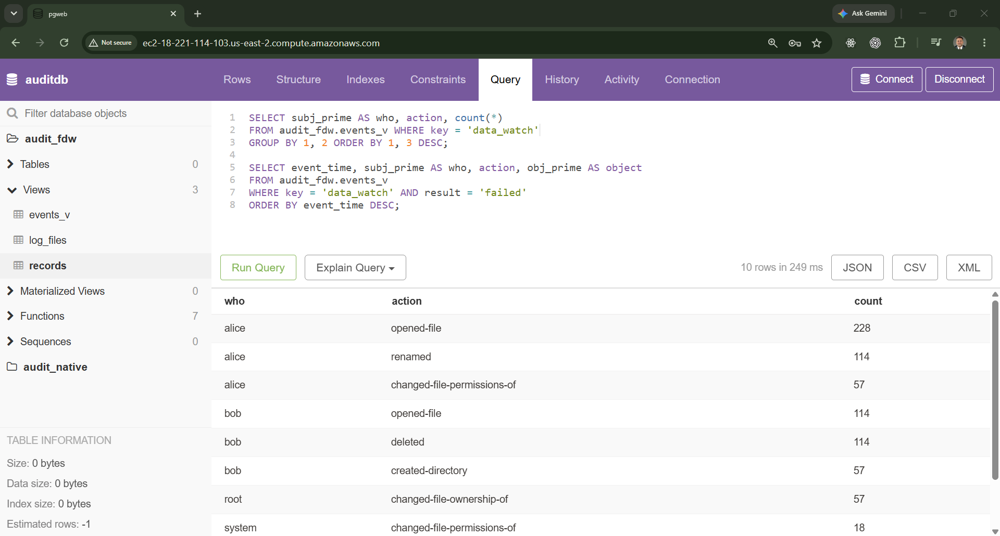

# Linux audit logs as PostgreSQL tables: file_fdw over auditd

Can a database query the operating system's audit trail **in place**, with no
pipeline that loads it first? This lab puts **auditd** and **PostgreSQL 18**
on one Ubuntu 26.04 host and exposes `/var/log/audit` as tables through
`file_fdw`: the active log, the rotated one and the compressed history, read
on every query. Next to it runs the conventional answer, a 60-second ingest
into an indexed table, and a benchmark suite that measures the two on the
same data. A **pgweb** host gives you a browser client.



| Piece | Where | Role |
|---|---|---|
| **auditd-server** | `auditd-subnet-1` | Ubuntu 26.04, `m7i.large`, 60 GB gp3; everything below runs here |
| **auditd 4.1.2** | auditd-server | watches `/data` (`-w /data -p wa -k data_watch`) and writes `/var/log/audit` |
| **PostgreSQL 18** | auditd-server | `localhost:5432`, database `auditdb`, schemas `audit_fdw` and `audit_native` |
| **audit-fdw wrappers** | `/usr/local/lib/audit-fdw/` | what the foreign tables run: `zcat -f` over the chain, then `ausearch` |
| **audit-ingest.timer** | auditd-server | every 60 s, `ausearch --checkpoint` → `COPY` into `audit_native.events` |
| **audit-rotate** | `/usr/local/sbin/` | rotates and compresses the chain (daily, or on demand) |
| **pgweb** | auditd-server | port 80, no saved connection; you sign in as `audit_reader` |
| **Secrets Manager** | regional | `auditd-postgres-credentials`: the `postgres` and `audit_reader` passwords |

## Architecture

<picture>
  <source media="(prefers-color-scheme: dark)" srcset="architecture-dark.svg">
  
</picture>

Regenerate with `python3 make_diagram.py`.

- **`01-server/`** is the whole stack: the VPC (`auditd-vpc`, 10.0.0.0/24)
  with one public subnet, the security group, the IAM role for SSM, the
  secret and the server.
- **`01-server/audit/`, `fdw/`, `sql/`, `systemd/`** are what cloud-init
  installs on the server.
- **`01-server/bench/`** holds the event generator, the corpus synthesizer,
  the benchmark queries and driver, and the results.

## How it works

### Two FDW layers

| Object | What it is |
|---|---|
| `audit_fdw.log_files` | the chain itself: name, size, modified, compressed, oldest first |
| `audit_fdw.raw_records` | every raw line, oldest file to newest (`zcat -f` passes plain files through and decompresses `.gz`) |
| `audit_fdw.records` | those lines parsed with regular expressions: `record_type`, `event_time`, `serial`, `fields` (jsonb, quoted and hex-encoded values decoded) |
| `audit_fdw.events` / `events_v` | one row per **event**: the chain piped into `ausearch --format csv`, typed in the view |
| `audit_fdw.search_events(from, to, key)` | the same, but with the filter passed to ausearch (`-ts -te -k`) |

A single syscall is several records (SYSCALL, CWD, PATH ×n, PROCTITLE)
sharing a serial number. The raw layer shows them as they are; correlating
them, resolving UIDs and naming the action ("renamed", "opened-file") is
what **ausearch** (through auparse) already does, so the event layer uses it
as the parser instead of reimplementing it in SQL.

`file_fdw` has no filter pushdown: every query runs the wrapper and reads the
**whole** chain, then PostgreSQL filters. `search_events()` exists to measure
what moving the filter into ausearch buys.

### Things ausearch does that the wrappers work around

Verified on ausearch 4.1.2 (details in [CLAUDE.md](CLAUDE.md)):

- It reads stdin only when stdin is a pipe. Under PostgreSQL stdin is
  `/dev/null`, and ausearch then silently searches the **system** logs. The
  wrappers always pipe the chain in.
- It exits 1 both for "no matches" and for real errors. The wrapper accepts
  exit 1 only when stderr says exactly `<no matches>`.
- Its CSV is not RFC 4180: nothing is quoted, so a comma in a file name adds
  a column and a `"` breaks PostgreSQL's CSV parser. The foreign tables use a
  quote byte that never occurs, and `csv-repair.awk` re-splits rows with
  extra commas. Non-UTF-8 bytes in relative paths come out raw;
  `utf8-clean` escapes them.
- DATE and TIME are local time, but the `GMT_OFFSET` column makes the
  timestamp exact; it matches the raw records' epoch to the millisecond.

### Rotation

auditd never compresses its logs, and on 4.1.2 `SIGUSR1` always performs
auditd's own rename-and-shift, so the usual logrotate recipe (rename, then
signal) scrambles the file order. Instead auditd's size-based rotation is off
(`max_log_file_action = ignore`) and `audit-rotate`:

1. runs the native ingest, so nothing in `audit.log.1` is compressed before
   it has been loaded;
2. takes an **exclusive** lock that the FDW wrappers and the ingest hold
   **shared** while they read, so no query ever sees a half-shifted chain;
3. shifts `.N.gz` → `.N+1.gz` and compresses `.1` → `.2.gz`;
4. sends `SIGUSR1`, and auditd renames `audit.log` → `.1` and opens a new
   file.

The result is always `audit.log`, an uncompressed `audit.log.1`, and
compressed history, which is what `log_files` shows.

## How it boots

1. Terraform builds the network, the role, the secret (two 24-character
   passwords) and the server.
2. cloud-init clones this repository and runs
   `01-server/scripts/setup_server.sh`: installs auditd, PostgreSQL 18 and
   sysstat; creates the `auditread` group (auditd's `log_group`, with
   `postgres` as a member, so PostgreSQL can read the logs but never write
   them); installs the rules, the wrappers and `audit-rotate`. Progress is
   in `/root/userdata.log`.
3. It builds `auditdb`: roles, both schemas and the ingest table
   (`/root/db_setup.log`), and starts `audit-ingest.timer`.
4. It installs pgweb 0.17.0 on port 80 (`/root/pgweb.log`).
5. It seeds the demo: as `alice` and `bob`, it creates, appends to,
   overwrites, chmods, chowns, renames and deletes files under `/data`, with
   one denied write per round, rotating in between. You start with an active
   log, a `.1` and several `.gz` files.
6. It writes `/root/bootstrap.done`, which `validate.sh` waits for.

## Security groups

```
internet ─80─▶ auditd-server (pgweb)
```

`auditd-http-sg` allows TCP/80 only. There is no 5432 rule: PostgreSQL
listens on localhost and is reached through pgweb on the same host. There is
no SSH either; use SSM Session Manager.

## Prerequisites

* [An AWS Account](https://aws.amazon.com/console/)
* [Install AWS CLI](https://docs.aws.amazon.com/cli/latest/userguide/getting-started-install.html)
* [Install Terraform](https://developer.hashicorp.com/terraform/install)
* [Install jq](https://jqlang.github.io/jq/download/)

If this is your first time watching our content, we recommend starting with
this video: [AWS + Terraform: Easy Setup](https://youtu.be/BCMQo0CB9wk).

## Deploy

```bash
git clone https://github.com/mamonaco1973/aws-postgres-auditd.git
cd aws-postgres-auditd
./apply.sh       # one phase: VPC, secret, auditd-server
```

Everything deploys to `us-east-2`. `apply.sh` ends by running `validate.sh`,
which waits for the server to finish bootstrapping (about 5 minutes) and
prints:

```
==========================================================================
 PROJECT ENDPOINTS
==========================================================================

 PGWEB Application:
   http://ec2-203-0-113-10.us-east-2.compute.amazonaws.com

 Connect with:
   Host localhost   Port 5432   Database auditdb
   User audit_reader   SSL mode disable

 Password:
   aws secretsmanager get-secret-value --region us-east-2 \
     --secret-id auditd-postgres-credentials --query SecretString --output text \
     | jq -r .audit_reader_password

 Shell on the server:
   aws ssm start-session --region us-east-2 --target i-0123456789abcdef0

==========================================================================
```

## Try it

Open the pgweb URL and connect with host `localhost`, port `5432`, user
`audit_reader`, the password from the command above, database `auditdb` and
SSL mode `disable`. The queries are in
[`01-server/sql/queries.sql`](01-server/sql/queries.sql).

1. **The files.** Nothing has been loaded anywhere; this is the directory.

   ```sql
   SELECT * FROM audit_fdw.log_files;
   ```

2. **Raw records of one rename**: about five records sharing one serial
   (SYSCALL, CWD, PATH for each directory and name, PROCTITLE).

   ```sql
   SELECT record_type, event_time, serial, raw_line
   FROM audit_fdw.records
   WHERE serial = (SELECT serial FROM audit_fdw.records
                   WHERE record_type = 'SYSCALL'
                     AND fields->>'SYSCALL' = 'renameat2'
                     AND fields->>'key' = 'data_watch'
                   ORDER BY event_time DESC LIMIT 1)
   ORDER BY record_type;
   ```

3. **Correlating by hand**: group the records of each event.

   ```sql
   SELECT serial, min(event_time) AS event_time,
          jsonb_agg(jsonb_build_object('type', record_type) || fields
                    ORDER BY record_type) AS records
   FROM audit_fdw.records
   WHERE serial IN (SELECT serial FROM audit_fdw.records
                    WHERE fields->>'key' = 'data_watch')
   GROUP BY serial ORDER BY serial DESC LIMIT 5;
   ```

4. **The same events, one readable row each**, through ausearch:

   ```sql
   SELECT event_time, serial, subj_prime AS who, action, result,
          obj_prime AS object, obj2
   FROM audit_fdw.events_v
   WHERE key = 'data_watch'
   ORDER BY event_time DESC LIMIT 20;
   ```

5. **No ETL.** Open a shell (`aws ssm start-session ...` from
   `validate.sh`), make more events, and run step 4 again. The new rows are
   there at once.

   ```bash
   sudo bash /opt/aws-postgres-auditd/01-server/bench/generate_events.sh --rounds 2
   ```

6. **Filter, sort, aggregate** like any table:

   ```sql
   SELECT subj_prime AS who, action, count(*)
   FROM audit_fdw.events_v WHERE key = 'data_watch'
   GROUP BY 1, 2 ORDER BY 1, 3 DESC;

   SELECT event_time, subj_prime AS who, action, obj_prime AS object
   FROM audit_fdw.events_v
   WHERE key = 'data_watch' AND result = 'failed'
   ORDER BY event_time DESC;
   ```

   `queries.sql` also has most-touched files and activity per hour.

7. **Rotate**, then run steps 1 and 6 again. The chain has shifted by one
   (`.1` is now `.2.gz`) and the counts are unchanged: older events are read
   from the compressed files.

   ```bash
   sudo audit-rotate
   ```

8. **The conventional copy** answers the same question from an indexed
   table, but runs up to 60 seconds behind:

   ```sql
   SELECT subj_prime AS who, action, count(*)
   FROM audit_native.events WHERE key = 'data_watch'
   GROUP BY 1, 2 ORDER BY 1, 3 DESC;

   SELECT * FROM audit_native.ingest_lag;
   SELECT * FROM audit_native.ingest_log ORDER BY run_id DESC LIMIT 10;
   ```

9. **One selective question, three ways.** Compare the plans: on `events_v`
   the Foreign Scan reads everything and "Rows Removed by Filter" does the
   work.

   ```sql
   EXPLAIN ANALYZE SELECT * FROM audit_fdw.events_v
   WHERE key = 'data_watch' AND event_time >= now() - interval '1 hour';

   EXPLAIN ANALYZE SELECT * FROM audit_fdw.search_events(
     now() - interval '1 hour', now(), 'data_watch');

   EXPLAIN ANALYZE SELECT * FROM audit_native.events
   WHERE key = 'data_watch' AND event_time >= now() - interval '1 hour';
   ```

## Findings

Measured on this lab (`m7i.large`, PostgreSQL 18.6, auditd 4.1.2) with a
synthetic 100,000-record log chain (50,300 events, 25 MB raw, 4.6 MB on disk
as active + `.1` + six `.gz` files). Median of 5 runs; cold = page cache
dropped and PostgreSQL restarted first. All event-level contenders returned
identical results.

Only this 100K query matrix was run in full. The scaling, freshness and
rotation figures below come from separate, smaller runs, noted on each;
the 1M and 10M query matrices and the concurrency (pgbench) phase were not
run.

| Query | FDW raw (regex in SQL) | FDW `events_v` (ausearch) | `search_events` | Native, btree |
|---|---|---|---|---|
| Full count | 4.4 s | 557 ms | – | 2.3 ms |
| Key + 1-hour window | 3.2 s | 554 ms | 110 ms | 1.1 ms |
| Group by user, action | 6.7 s | 562 ms | – | 10.5 ms |
| One event by serial | 3.6 s | 557 ms | – | 0.7 ms |
| Top-10 files | 5.2 s | 562 ms | – | 7.2 ms |
| Failed ops, 24 h | 3.6 s | 558 ms | 177 ms | 2.0 ms |

Warm runs shown; cold adds about 100 ms to the FDW and 60–100 ms to native.

- **Every FDW query costs the same**, whatever it asks: about 0.55 s, because
  each one re-reads and re-parses the whole chain (no pushdown). That cost
  grows with the logs: a single full ausearch pass over each corpus took
  0.5 s at 100K records, 4.8 s at 1M and 51 s at 10M. Those are single
  passes, not the query matrix, but they put every FDW query at 1M around
  5 s and at 10M around a minute.
- **Filtering inside ausearch** (`search_events`) cut a selective query from
  554 ms to 110 ms and CPU from 0.98 s to 0.18 s, but it still reads every
  record.
- **Parsing raw records with SQL regexes** costs 6–12× more than letting
  ausearch do it.
- **Native** answers in milliseconds, but it is a copy: 8.5 MB of table and
  2.5 MB of btree indexes for 4.6 MB of compressed logs, loaded in 0.9 s.
- **Freshness:** in spot checks a new event was visible through `events_v`
  within 0.2–1.2 s, which is what the design predicts: the next query sees
  it, and a query takes about 0.55 s. The native table waits for the next
  60-second ingest. The 20-sample freshness phase was stopped early, so
  there is no median or p95.
- **Concurrency: not measured.** By the numbers above, each `events_v`
  query burns about 1 CPU-second at 100K on a 2-vCPU `m7i.large`, and
  concurrent queries share nothing (each starts its own `zcat` and
  `ausearch`), so more than two at once should queue for CPU. That is an
  expectation, not a result; `run_bench.sh --phases concurrency` measures
  it.
- **Rotation:** writing 10,000 events while rotating every 3 seconds and
  counting continuously gave no duplicates, no gaps and no lost events;
  both the FDW and the native table ended at exactly 10,000 (3 runs, on a
  test instance).

## When to use which

| Need | Better choice | Why |
|---|---|---|
| See an event the moment it happens | FDW | visible on the next query (spot checks: about a second) vs up to 60 s |
| No extra storage, no pipeline to run | FDW | the logs are the table |
| Occasional ad-hoc questions on recent logs | FDW | half a second per query is fine at 100K |
| Repeated or selective queries | Native | milliseconds vs half a second (measured), and FDW cost grows with log size |
| Many users querying at once | Native (expected) | every FDW query re-parses the whole chain on its own; not measured |
| History beyond log rotation and retention | Native | the FDW sees only the files that still exist |

## Limits

- **Managed PostgreSQL can't do this.** RDS, Aurora, Cloud SQL, Azure
  Database for PostgreSQL Flexible Server and OCI Database with PostgreSQL
  give you no access to the host's files and no `COPY ... PROGRAM` /
  `file_fdw program`. RDS's `log_fdw` reads only PostgreSQL's own logs.
- **Containers** need a read-only bind mount of `/var/log/audit`, ausearch
  inside the image, and the audit log group's GID mapped to the container's
  postgres user. On Kubernetes that means a `hostPath` volume, which ties
  the pod to one node.
- **Security.** The postgres OS user can read the whole audit trail, so
  SELECT on these tables is audit-log access, and SQL injection in any
  application on this database becomes audit-log disclosure. The wrappers
  are root-owned and validate every argument, `search_events` accepts only
  a key matching `^[A-Za-z0-9_-]{1,64}$` and timestamps it formats itself,
  and `audit_reader` has no `pg_read_server_files` or
  `pg_execute_server_program`. pgweb on port 80 is plain HTTP; this is a
  lab.
- **Development and maintenance.** ausearch's CSV columns and normalizer
  vocabulary can change between audit-userspace releases. The wrapper checks
  the header and fails loudly if it changes; the event names (`renamed`,
  `opened-file`) would change silently. Known parsing limits: a file name
  containing `,<digits>,` is split in the wrong place, and a rename whose
  target is given as a bare directory is resolved against the process's
  working directory.

## Prior art

- **`file_fdw` + ausearch**: this lab.
- **[Multicorn2](https://github.com/ShaheedHaque/multicorn2)**: Python FDWs,
  which could push `WHERE` clauses into the reader. Evaluated, not built: it
  is a compiled extension that runs Python inside the database server, and
  it isn't in the Ubuntu archive. Its README says v3.1 supports
  PostgreSQL 18 (latest v3.2); the original `pgsql-io/multicorn2`
  repository was no longer reachable in November 2026, only mirrors.
- **[laurel](https://github.com/threathunters-io/laurel)**: an auditd plugin
  that rewrites events as enriched JSON lines, a better input for log
  pipelines than ausearch CSV.
- **[osquery](https://osquery.io/)**: the closest relative of "the OS as
  virtual SQL tables", including tables fed from the Linux audit subsystem
  (`process_events`, `socket_events`). It runs its own agent and SQLite
  engine rather than PostgreSQL.
- **[pgaudit](https://github.com/pgaudit/pgaudit)**: a different thing:
  auditing of PostgreSQL's own sessions and statements.

## Troubleshooting

| Symptom | Fix |
|---|---|
| pgweb doesn't load | The server is still bootstrapping. `aws ssm start-session --region us-east-2 --target <id>`, then `sudo tail /root/userdata.log`. |
| `auditdb` or the schemas are missing | Check `/root/db_setup.log`. |
| A query on `audit_fdw` fails with `audit-fdw: ...` | That's the wrapper's message (ausearch error, header change). More detail is in `/var/log/postgresql/`. |
| `audit_native` is behind | `systemctl status audit-ingest.timer`; `SELECT * FROM audit_native.ingest_log ORDER BY run_id DESC`. |
| `audit-rotate` refuses to run | Someone ran `service auditd rotate` by hand and left an uncompressed `.2`; compress or remove it. |

## Teardown

```bash
./destroy.sh     # destroys the whole stack; the secret is deleted immediately
```

## Notes

- **Lab only.** pgweb runs over plain HTTP with no sign-in of its own, and
  the database passwords are in the host's user data. The `audit_reader`
  password is the only thing between the internet and your audit trail.
